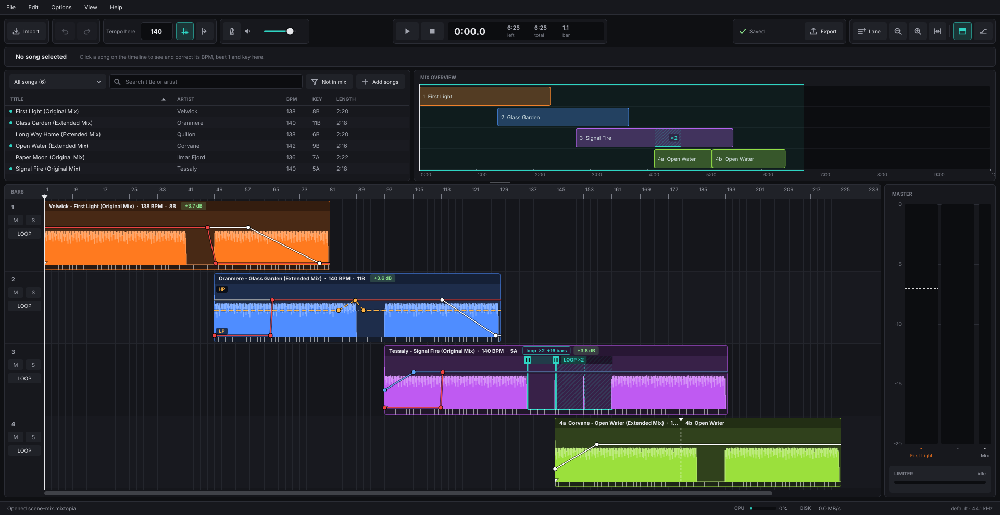
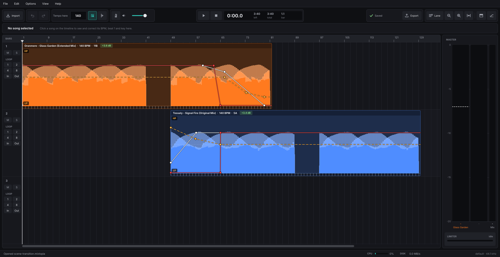

# Mixtopia

**A timeline mix and mashup editor for Linux.** Lay your songs out on a timeline, line up their beats, shape the
transitions by hand, and export one seamless mix.

I'm a trance DJ who spent years making mixes in MixMeister Fusion, and when I moved to Linux I couldn't find
anything like it. So I built it. Mixtopia is for the way I like to work: no live performance, no effects rack, just
you, your songs, and all the time you want to make the transitions sound right.

It's free, it works offline, and it comes as a single file: download the AppImage, make it executable, run it.

**Status:** finished and in daily use for my own mixes. I'm not planning further development, but I'm glad to share
it.

*A whole mix: four songs across four lanes with their volume, EQ and filter lines, a repeated part (the hatched
loop on lane 3) and a song cut into two pieces (lane 4). Above: the library and the mix overview.*

*One transition up close: the outgoing song's bass is cut and it fades out through a low-pass filter while the
incoming song fades in, its bass comes in on the bar and its high-pass filter opens. The library is hidden (View >
Library and Mix Overview).*

(The songs in these screenshots were generated for them - synthetic test tracks with made-up artist names.)

## What you can do with it

- **Build a mix on a timeline.** Drag MP3, FLAC and WAV files onto as many lanes as you need. Move, trim, and zoom in
  until each pixel is a couple of samples.
- **Beats that line up.** Mixtopia finds each song's tempo and first beat for you. You can correct either by hand,
  and every song is stretched to the project tempo without changing its pitch. A beat rail along each song shows
  its bars and beats, and with Snap on, a song's first beat lands on a bar line.
- **Change tempo along the way.** Add tempo points to speed up or slow down smoothly over bars.
- **Draw your transitions.** Every song has its own volume, bass, mid, treble and filter lines. Add points and drag
  them to shape the lines. The filter sweeps from low-pass through "off" to high-pass.
- **Loop and chop.** Repeat any part of a song up to 64 times, seamlessly. Cut songs into pieces and rearrange or
  copy them, which is great for mashups.
- **Camelot keys.** Each song's key is detected and shown in Camelot notation (8A, 11B, ...), and you can correct it
  by hand. **Note: Key detection, even with commercial products can be spotty. Don't take it as gospel.**
- **Match the loudness.** Quieter songs can be raised automatically towards a loud level (never turned down), and a
  master limiter keeps the mix from clipping.
- **Know what you'll hear.** Playback and export use the same engine, so the exported file sounds like what you
  heard.
- **Export.** MP3 (320 kbps) or FLAC (16-bit), with title, artist, album, genre, year and a cover image.
- **Keep a music library.** A library with collections, search, and sorting by title, artist, BPM, key and length.
  Songs are added by hand (files or folders you choose), so nothing scans your drives behind your back.
- **Don't lose your work.** Undo and redo, autosave, and a safety copy of your last manual save.

## What it isn't

Mixtopia is for **making** mixes, not for performing them live. It's not a full music studio, and it has no effects
except the filter. It doesn't import MixMeister projects. It runs on Linux only.

## Getting started

1. Download `Mixtopia-x86_64.AppImage` from the [latest release](../../releases/latest).
2. Make it executable: right-click it, Properties, "Allow executing as a program" (or
   `chmod +x Mixtopia-x86_64.AppImage`).
3. Run it.
4. Drag a song onto the timeline. Mixtopia finds its tempo and first beat, and places it on the grid. Drag in a
   second song and move it to where the mix should start.
5. Press Space to play. Add volume and EQ points to build the transition.
6. File > Export when you're happy.

**You'll need** an x86_64 Linux system with glibc 2.38 or newer and the C++ library from GCC 13 or newer, a sound
system that speaks ALSA (PipeWire's ALSA support is fine), and X11 or XWayland. Ubuntu 22.04 and Debian 12 are too
old.

**FUSE:** an AppImage normally mounts itself with FUSE (`fusermount`). If your system has no FUSE - for example inside
a container - start it with `./Mixtopia-x86_64.AppImage --appimage-extract-and-run`, or unpack it once with
`--appimage-extract` and run `squashfs-root/AppRun`.

**Tested on** (November 2026): Bazzite (Fedora-based), as a normal desktop app. And in containers on that machine,
Ubuntu 24.04 and Arch Linux, with the AppImage unpacked (containers have no FUSE): no library missing, the self-tests
passed, a saved project opened and closed normally, and playback was recorded through PipeWire (not played aloud) and
checked for gaps. The same test mix exported there gave MP3 files bit-identical to the Bazzite export, and FLAC files
identical within dither (FLAC exports add random dither, so two FLAC exports are never bit-identical).

Open **Help > Keyboard Shortcuts** for the full list. A few favourites: `Space` play / pause, `C` cut at the
playhead, `V` `B` `G` `T` `R` add a volume / bass / mid / treble / filter point at the mouse, `I` `O` `E` loop in /
loop out / loop panel, `Ctrl+D` duplicate, `Ctrl+Z` undo.

## Good to know

- Automatic beat grids are usually right, but dense songs can fool them. If the beat looks off, set beat 1 by hand.
  The metronome button in the toolbar helps you check by ear.
- The first time you add a song, it takes a few seconds to decode and analyse (tempo, beat, key, loudness). After that
  it's instant.
- Songs you put on the timeline are decoded once into a cache (10 GB by default, adjustable under Options). Songs you
  only browse in the library aren't copied.
- Mixtopia stores its settings and library in `~/.config/Mixtopia` and its cache in `~/.cache/Mixtopia`. It never
  writes to your music files.

## How it was made

I have no programming background. I built Mixtopia by describing what I wanted, with
[Claude](https://claude.ai) (Anthropic's AI) writing the code, and by testing each stage by ear before moving on. I'm
telling you because I think it's an honest story, and because I hope it encourages other people who have a tool in
mind to try building it.

## Provided as is

I made Mixtopia for myself and I'm sharing it in the hope it's useful to someone else. It is provided as is, without
warranty. There is no support and no issue tracking: I can't promise fixes or new features. You're very welcome to
fork it and make it your own under the licence below.

## Building from source

See [BUILDING.md](BUILDING.md): an Ubuntu 24.04 environment (a container works well), the pinned dependencies fetched
by `scripts/fetch-deps.sh`, then `scripts/build.sh` and `scripts/package-appimage.sh`.

## Thanks

Mixtopia stands on the shoulders of excellent open-source projects: [JUCE](https://juce.com),
[Tracktion Engine](https://github.com/Tracktion/tracktion_engine),
[Signalsmith Stretch](https://github.com/Signalsmith-Audio/signalsmith-stretch),
[Rubber Band](https://breakfastquay.com/rubberband/), [libKeyFinder](https://github.com/mixxxdj/libkeyfinder),
[mpg123](https://www.mpg123.de), [LAME](https://lame.sourceforge.io), [FFTW](https://www.fftw.org), and the
[Inter](https://rsms.me/inter/) typeface, plus the smaller libraries bundled with Tracktion. The full list and
notices are in [NOTICE](NOTICE).

## Licence

Mixtopia is licensed under the GNU Affero General Public License, version 3 (AGPL-3.0) - see [LICENSE](LICENSE).
Because it is built on JUCE under the AGPLv3, the program as a whole is AGPL-3.0; [NOTICE](NOTICE) lists the licences
of everything it includes. Mixtopia is not affiliated with MixMeister, Mixed In Key or any other product named here.
